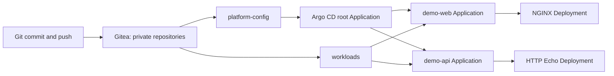

# Argo CD Kubernetes homelab

A reproducible GitOps lab using **K3s through k3d**, with one control-plane node
and one worker node running in separate Docker containers. Kubernetes runs Gitea,
the standard Argo CD components, and two demo applications using different images:
unprivileged NGINX and HashiCorp HTTP Echo.

The two private Git repositories separate platform Application definitions from
workload manifests. Argo CD uses a dedicated account with read access to both.



## Start

Install Docker Engine, k3d, kubectl, Git, Make and Python 3. See the
[installation guide](docs/INSTALLATION.md) for prerequisites and every step.

```bash
make up
make credentials
make status
```

| Service | Local URL |
| --- | --- |
| Argo CD | http://argocd.localhost:8080 |
| Gitea | http://gitea.localhost:8080 |
| NGINX application | http://web.localhost:8080 |
| HTTP Echo application | http://api.localhost:8080 |

Ports are bound to `127.0.0.1`. These HTTP endpoints are for local experiments.
The [production guide](docs/PRODUCTION.md) covers HA, TLS, SSO, repository access,
deployment review, backups and recovery on a real Kubernetes cluster.

## Layout

```text
cluster/k3d.yaml                  Two Kubernetes node containers plus k3d load balancer
kubernetes/gitea/                Git server, persistent storage, Service and Ingress
kubernetes/argocd/overlays/      Pinned Argo CD installation: lab and production
bootstrap/                      Namespaces, AppProjects and root Application
repositories/platform-config/   Template for the platform Git repository
repositories/workloads/         Template for the workload Git repository
scripts/                        Bootstrap and credential helpers
docs/                           Installation, GitOps exercises and production migration
.state/                         Generated kubeconfig, passwords and Git working copies
```

After seeding, edit and push `.state/repositories/workloads/` or
`.state/repositories/platform-config/`. The `repositories/` directories are
initial templates; rerunning the seed command preserves existing working copies.

The lab has two **node** containers; k3d also creates a load balancer container,
and Kubernetes creates multiple workload containers. Argo CD itself requires its
controller, API server, repository server and Redis plus supporting components.
This is a standard multi-component Argo CD installation.

## Versions and boundaries

| Component | Pin |
| --- | --- |
| k3d CLI baseline | v5.8.3 |
| K3s | v1.34.12-k3s1 |
| Argo CD | v3.5.3 |
| Gitea | 1.26.4-rootless |
| NGINX | nginxinc/nginx-unprivileged:1.29.4-alpine |
| HTTP Echo | hashicorp/http-echo:1.0.0 |

Argo CD's [published compatibility matrix](https://argo-cd.readthedocs.io/en/stable/operator-manual/installation/)
includes Kubernetes 1.34 for the 3.5 release line. Its
[v3.5.3 release](https://github.com/argoproj/argo-cd/releases/tag/v3.5.3)
provides the pinned standard and HA manifests used here. Recheck supported
versions and security updates before a production rollout.

K3s exposes real Kubernetes APIs. This lab exercises Deployments, Services,
Ingress, storage, RBAC and reconciliation, but a single Docker host cannot model
independent machine failures or cloud load balancers. Lab Gitea uses SQLite and
node-local volumes; cluster deletion loses that data. Export repositories and
backups before `make down`.

Creation-time validation covers YAML parsing, local manifest references, shell
syntax and Python syntax. A live cluster rollout has not been performed in the
authoring environment; follow the guide's runtime checks on your Docker host.

